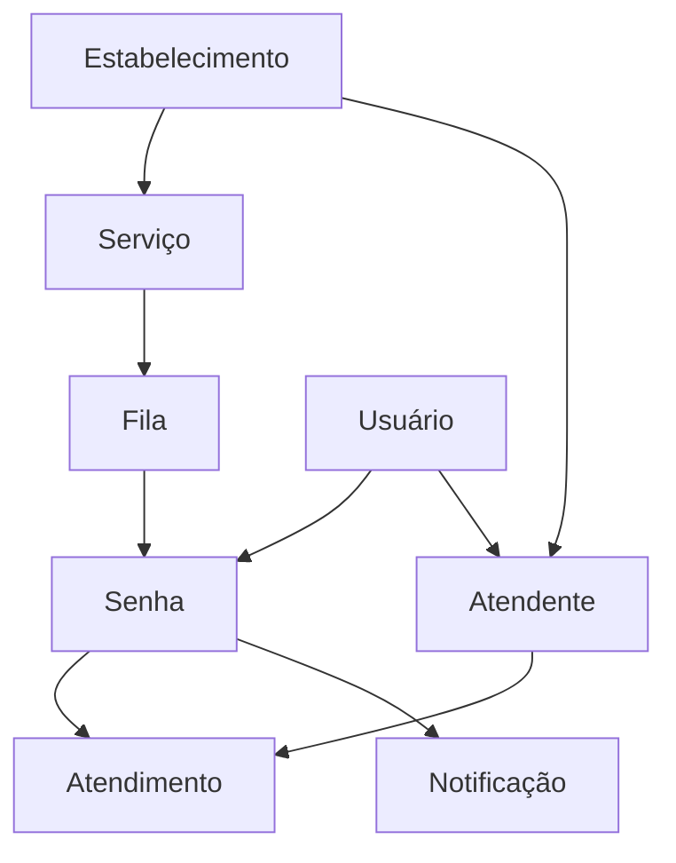

# Modelo de Domínio — FilaSmart

## Entidades e vínculos

`usuarios` centraliza a identidade e os perfis `usuario`, `atendente`, `admin` e `totem`. O estabelecimento é opcional na identidade; permissões e vínculos operacionais são verificados no Xano.

`atendentes` liga uma conta ao estabelecimento, guichê e estado ativo. `atendimentos` registra início e fim de um atendimento ligado à senha e ao atendente. Os serviços pertencem ao estabelecimento e as filas pertencem ao serviço.

O acompanhamento usa referências temporárias em `rastreamentos_senha`; displays usam credenciais restritas em `tv_displays`. Os dados e guardas estão nos exports de `xano/table/` e `xano/api/`.
